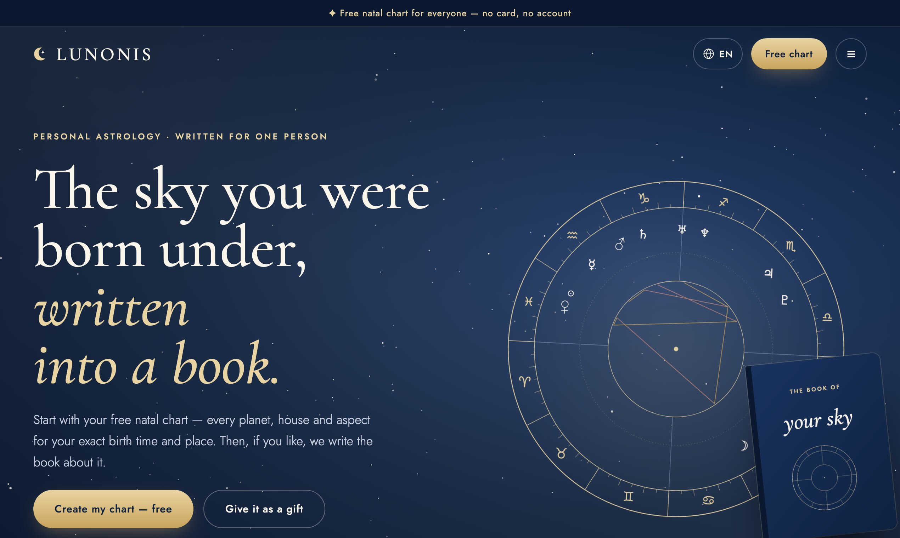
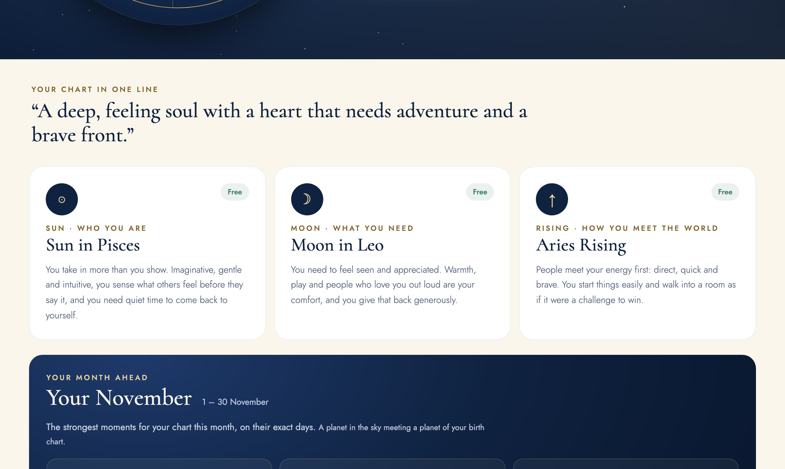
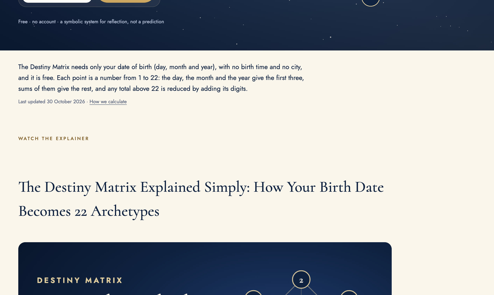
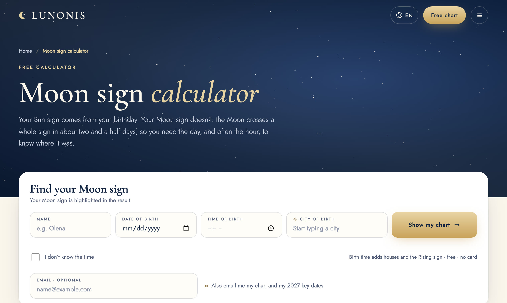
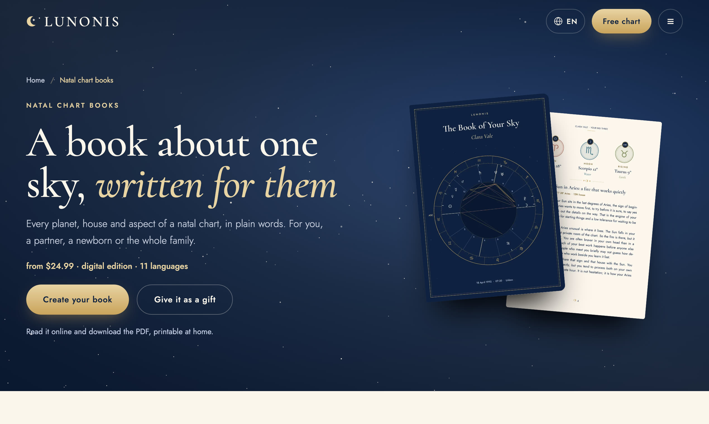
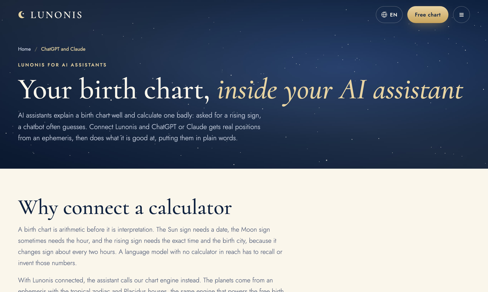

<p align="center"><a href="https://lunonis.com"></a></p>

<h3 align="center">Astrology, calculated exactly. Explained in your language.</h3>

<p align="center">
<a href="https://lunonis.com">lunonis.com</a> ·
<a href="https://lunonis.com/destiny-matrix">Destiny Matrix</a> ·
<a href="https://lunonis.com/developers/mcp">MCP server</a> ·
<a href="https://www.youtube.com/@lunonis">YouTube</a>
</p>

---

**Lunonis** calculates your birth chart from an ephemeris and explains it in plain language. Free, no account needed, in 11 languages: English, Portuguese, Spanish, French, German, Italian, Turkish, Ukrainian, Polish, Japanese and Chinese.

- **Free natal chart:** Placidus houses, every planet with sign, degree and house, the tightest aspects.
- **Free calculators:** rising sign, Moon, Venus and Mars signs, Saturn return, compatibility (synastry), Destiny Matrix, tarot.
- **Personal forecasts:** your month read from your own transits.
- **PDF astrology books** written for one chart, a couple, a baby or a family.
- **For AI assistants:** a free remote MCP server so Claude, ChatGPT, Cursor and VS Code can calculate real charts (see below).

## Screenshots

| Home | Your chart |
|---|---|
|  |  |
| **Destiny Matrix** | **Moon sign** |
|  |  |
| **Astrology books** | **For AI assistants** |
|  |  |

## MCP server for AI assistants

A free, remote [Model Context Protocol](https://modelcontextprotocol.io) server. Positions come from an ephemeris, not from the model.

- **Endpoint:** `https://lunonis.com/mcp` (Streamable HTTP, no auth, nothing stored)
- **Registry:** `com.lunonis/astrology` in the [official MCP Registry](https://registry.modelcontextprotocol.io/v0.1/servers?search=com.lunonis/astrology)
- **Tools:** `natal_chart`, `compatibility`, `search_places` (all read-only)
- **Docs:** https://lunonis.com/developers/mcp

```bash
# Claude Code
claude mcp add --transport http lunonis https://lunonis.com/mcp
```

```json
{ "mcpServers": { "lunonis": { "type": "http", "url": "https://lunonis.com/mcp" } } }
```

## Contact

hello@lunonis.com · For reflection, not prediction.
